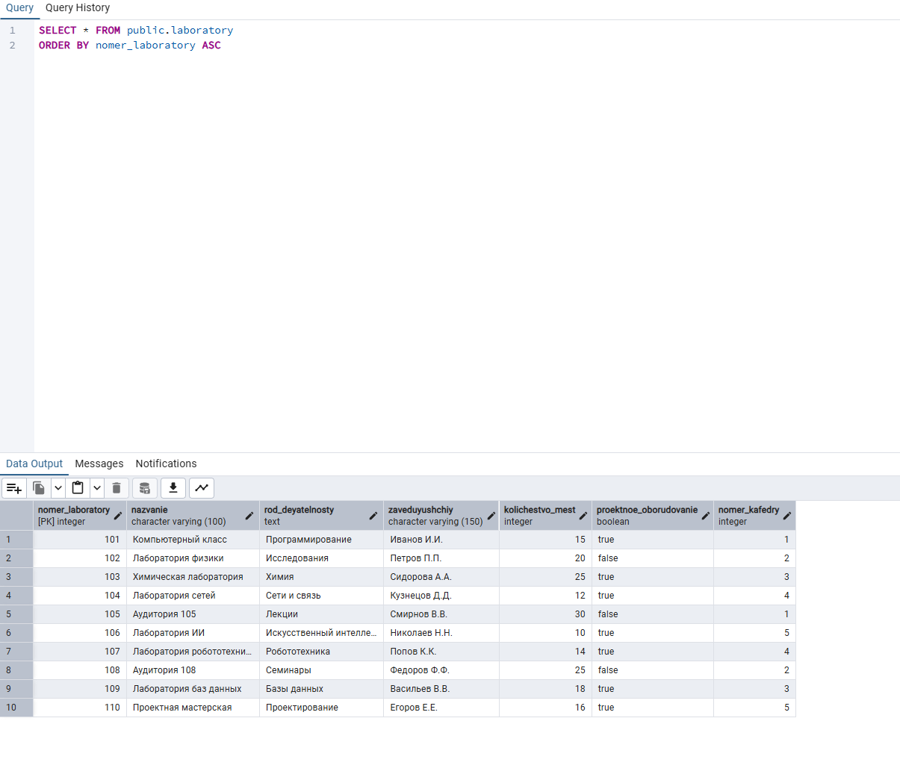
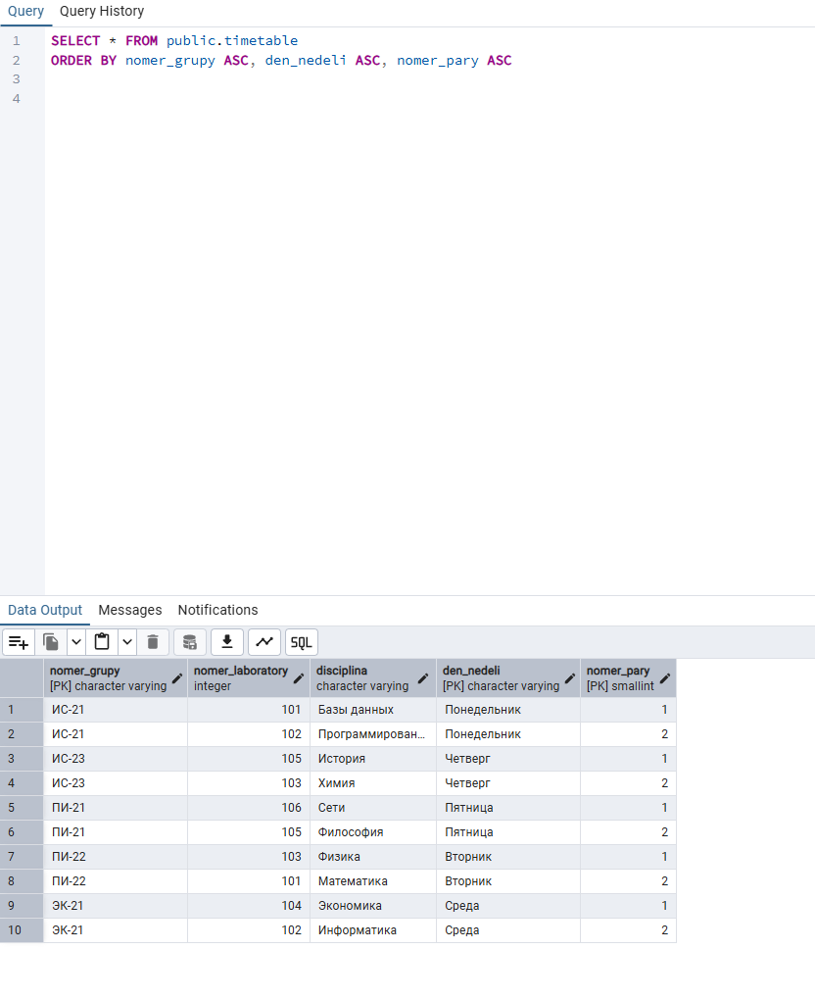
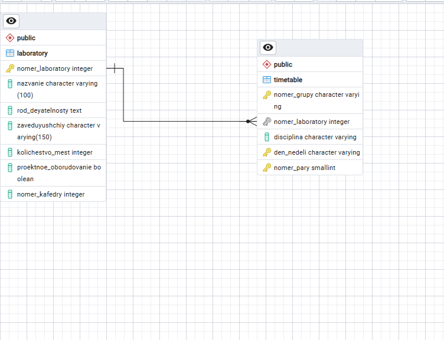
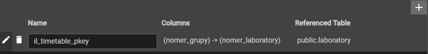
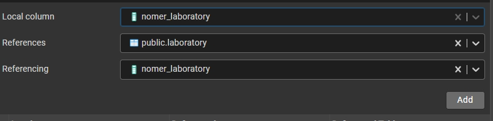
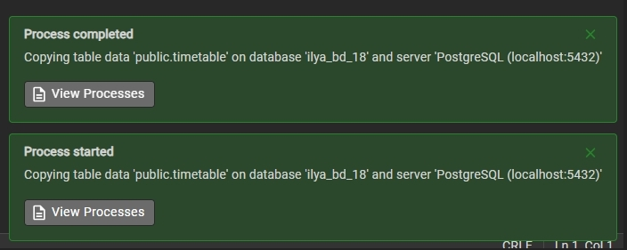
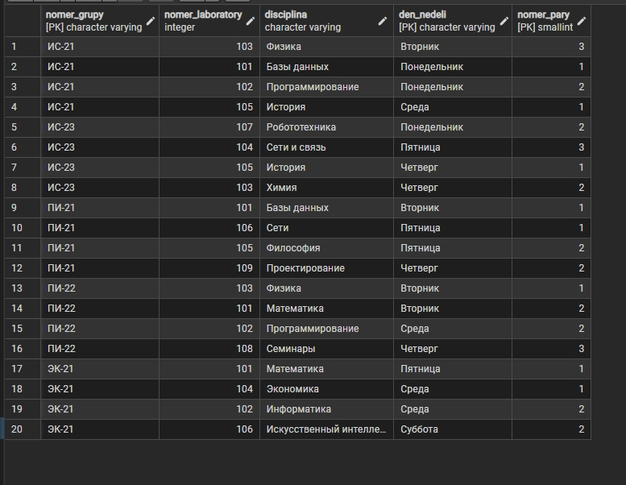
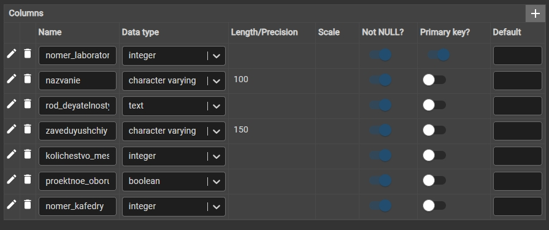
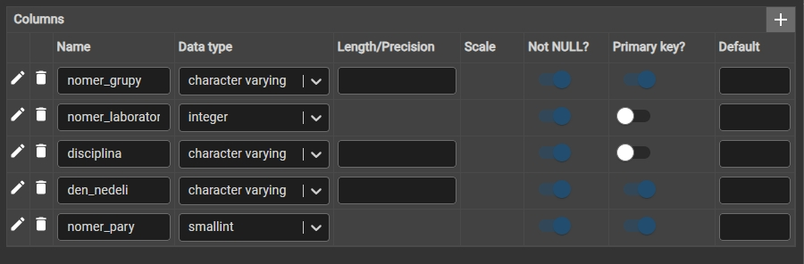

# Лабораторная работа №1. Вариант 18

**Тема:** Создание таблиц и обеспечение целостности данных в PostgreSQL.
**Вариант 18:** Расписание / Лаборатории.

## 📁 Состав репозитория

| Файл | Описание |
|---|---|
| `laboratory.sql` | SQL-скрипт создания таблицы `laboratory` (DDL) |
| `timetable.sql` | SQL-скрипт создания таблицы `timetable` (DDL) |
| `code_zapolninoytable1.sql` | SQL-скрипт заполнения таблицы `laboratory` (DML) |
| `code_zapolninoytable2.sql` | SQL-скрипт заполнения таблицы `timetable` (DML) |
| `06_laboratories_import.csv` | CSV-файл для импорта данных через мастер pgAdmin |

## 🗄 База данных и связи
База данных: `University_Schedule`

На ERD-диаграмме отображена связь «один-ко-многим» (1:M):
* **`laboratory`** (главная таблица, первичный ключ `nomer_laboratory`).
* **`timetable`** (зависимая таблица, внешний ключ `nomer_laboratory`).

Внешний ключ настроен с параметрами `ON UPDATE CASCADE` и `ON DELETE CASCADE`.

---

## 📸 Скриншоты выполнения работы

### 1. Создание таблиц в конструкторе
**Таблица laboratory:**

**Таблица timetable:**

### 2. ERD-диаграмма базы данных

### 3. Проверка внешних ключей (Foreign Key)

### 4. Импорт данных через мастер pgAdmin

### 5. Данные в таблицах после заполнения
**Таблица laboratory:**

**Таблица timetable:**

